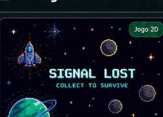
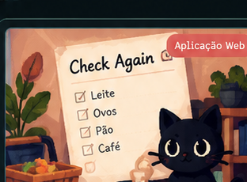
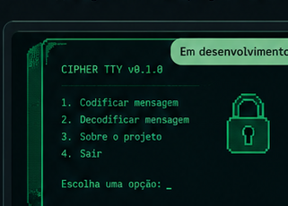

<h1>Olá, eu sou a Aline </h1>

**Ciência da Computação · Desenvolvimento de Software · Sistemas e Infraestrutura**

Sou estudante de Ciência da Computação, técnica em Informática e atuo na área de TI, com experiência prática em suporte técnico e infraestrutura.

Gosto de compreender como os sistemas funcionam, investigar problemas e desenvolver soluções. Tenho interesse em Engenharia de Software, desenvolvimento de sistemas e automação, explorando também diferentes tecnologias e abordagens.

Nos meus projetos autorais, combino programação, lógica, criatividade e design, experimentando desde aplicações web e jogos até novas possibilidades com inteligência artificial.

---

<h2> Projetos autorais</h2>

<table>
  <tr>
    <td width="33%" valign="top">
      
      <h3> Signal Lost</h3>
      
Minigame 2D para navegador, com movimento, colisões, estados de jogo e interface em Canvas.

      
 

      
<a href="https://github.com/alineopinho/signal-lost">Explorar repositório</a>

    </td>
    <td width="33%" valign="top">
      
      <h3> Check Again</h3>
      
Lista de compras interativa com uma proposta de experiência narrativa, focada em lógica e fluxo do usuário.

      
  

      
<a href="https://github.com/alineopinho/check-again">Explorar repositório</a>

    </td>
    <td width="33%" valign="top">
      
      <h3> CipherTTY</h3>
      
Laboratório educativo de criptografia clássica com terminal retrô e exploração livre de comandos.

      
 

      
<a href="https://github.com/alineopinho/ciphertty">Ver conceito e documentação</a>

    </td>
  </tr>
</table>

As capas são artes conceituais; não representam capturas reais dos aplicativos.

<h2> Engenharia de Software e estudos</h2>

- [VetCare — Engenharia de Software](https://github.com/alineopinho/vetcare-engenharia-software): requisitos, modelagem, rastreabilidade e QA.
- [Guia Git & GitHub](https://github.com/alineopinho/guia-git-github): anotações e procedimentos práticos para versionamento.

<h2> Tecnologias e ferramentas</h2>

**Desenvolvimento:** JavaScript, HTML, CSS, Python, Java e C#  
**Dados:** SQL, MySQL e PostgreSQL  
**Sistemas e infraestrutura:** Windows, Linux, redes TCP/IP e Docker  
**Ferramentas:** Git, GitHub e VS Code

*Em exploração:* React, TypeScript, automação, Cloud, DevOps e desenvolvimento de jogos.

<h2> Experiência e formação</h2>

Estudante de **Ciência da Computação** e técnica em **Informática**. Tenho experiência prática com suporte técnico, diagnóstico de problemas, configuração de estações, autenticação, conectividade e infraestrutura de TI.

<h2> Minhas contribuições</h2>

<picture>
  <source media="(prefers-color-scheme: dark)" srcset="https://raw.githubusercontent.com/alineopinho/alineopinho/output/github-snake-dark.svg" />
  <source media="(prefers-color-scheme: light)" srcset="https://raw.githubusercontent.com/alineopinho/alineopinho/output/github-snake.svg" />
  
</picture>

  
  <em>Entender como funciona. Construir. Testar. Melhorar.</em>
  

